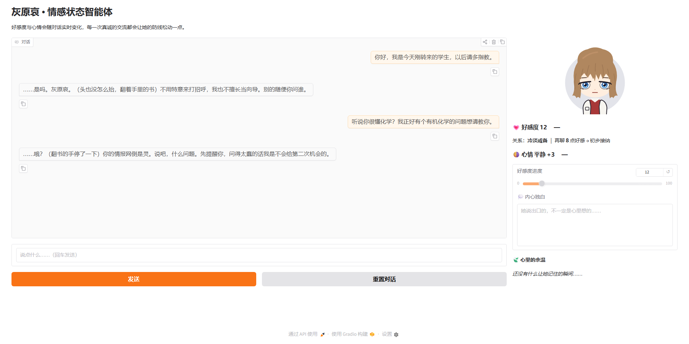
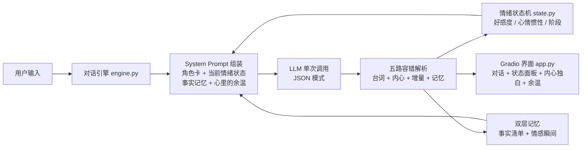

# 灰原哀 · 情感状态智能体 (Haibara AI)

一个基于 LLM 的角色扮演情感智能体：与《名侦探柯南》中的灰原哀对话，她的**好感度、心情、关系阶段**会随对话实时演化——从最初的冷淡戒备，到毒舌熟人，再到愿意袒露内心。说出口的台词之下，还能看到她的**内心独白**。



## 特性

- **情感状态机**：好感度（0-100，长期）与心情（-100~100，短期）双变量建模，每轮对话由 LLM 输出增量，程序端维护状态并限制单轮涨幅——好感需要慢慢"攻略"
- **情绪余韵**：心情不是每轮清零，而是保留四成惯性再叠加新刺激——开心会延续、被冒犯会低落，真诚道歉后又能慢慢回暖
- **五段关系阶段**：冷淡戒备 → 初步接纳 → 毒舌熟人 → 有限信任 → 袒露内心，阶段直接注入 System Prompt 驱动语气变化
- **同脑生成**：台词、内心独白、情绪增量在单次 LLM 调用中一起产出（JSON 模式），嘴上说的和心里想的出自同一个"脑子"，才有"嘴硬心软"的张力；每轮回复附带一句第一人称 OS
- **双层记忆**：旧对话溢出窗口时自动压缩为事实清单（她"记得"你说过的事）；情绪波动强烈的瞬间另存为"心里的余温"（她记得让你心动或受伤的场景），持续影响后续对话
- **模型无关**：支持任意 OpenAI 兼容 API（智谱 GLM / DeepSeek / GPT-4o / 各类中转……），改三个环境变量即可切换；默认推荐免费的智谱 `glm-5.3-flash`
- **无 Key 演示模式**：未配置 API Key 时自动降级为脚本演示，界面和状态机照常运转，适合课堂展示

## 架构



每轮对话，LLM 在同一个 JSON 里给出台词、内心独白、情绪增量与可选的情感记忆：

```json
{
  "reply": "（指尖在杯壁停了一瞬）……甜了点。",
  "favorability_delta": 2,
  "mood_delta": 5,
  "inner_voice": "笨蛋，谁准你记住的……",
  "memory": "他记住了她说过的'偏咸'，第二天递来甜口的蛋卷。"
}
```

程序端更新状态机（心情带惯性衰减）、沉淀记忆，并在下一轮把新状态与记忆注入 Prompt，形成闭环。解析器对模型不规范输出有五级容错：整体 JSON → 嵌入 JSON → STATE 标签 → 裸 JSON → 截断正则抢救。

## 快速开始

```bash
# 1. 安装依赖（需要 Python 3.10+）
pip install -r requirements.txt

# 2. 配置 API：复制 .env.example 为 .env，填入你的 key
cp .env.example .env

# 3. 启动网页界面
python app.py        # 浏览器打开 http://127.0.0.1:7860

# 或者先用终端试聊，快速调人设
python cli.py
```

> **没有 API Key 也能跑**：未配置 `LLM_API_KEY` 时自动进入演示模式，用内置剧本回复，方便先看界面和状态机效果。

## 配置

| 环境变量 | 说明 | 默认 |
|---|---|---|
| `LLM_API_KEY` | API 密钥 | 不填则进入演示模式 |
| `LLM_BASE_URL` | OpenAI 兼容接口地址 | `https://open.bigmodel.cn/api/paas/v4/` |
| `LLM_MODEL` | 模型名 | `glm-5.3-flash`（智谱，免费） |

免费 Key 获取：注册 [智谱开放平台](https://open.bigmodel.cn) → 控制台「API Keys」→ 添加并复制。新账号有免费 token 额度，`glm-5.3-flash` 的角色扮演细腻度与 JSON 稳定性都明显优于旧版 `glm-4-flash`；若该模型临时限流，可把 `LLM_MODEL` 改成 `glm-4-flash` 兜底。

## 项目结构

```
haibara-ai/
├── app.py          # Gradio 网页界面
├── cli.py          # 终端试聊工具（调人设用）
├── engine.py       # 对话引擎：LLM 调用、五路容错解析、事实与情感双层记忆
├── character.py    # 灰原哀角色卡 + System Prompt 模板
├── state.py        # 情绪状态机（好感度 / 心情 / 阶段）
├── .env.example    # 配置模板
└── requirements.txt
```

## 调试指南

- **人设不像 / 语气不对**：只改 [character.py](character.py) 里的角色卡，用 `python cli.py` 快速验证
- **好感涨太快或太慢**：改 [state.py](state.py) 里的 `MAX_FAV_DELTA` 和各阶段阈值
- **心情平复太快或太慢**：改 [state.py](state.py) 中 `apply()` 的惯性系数（当前保留 0.4 上一轮心情）
- **哪些瞬间值得她记住**：改 [engine.py](engine.py) 的 `_memory_tag()` 情绪阈值

## Roadmap

- [ ] 多角色扩展（角色卡插件化）
- [ ] 语音合成（TTS）朗读台词
- [ ] 情绪曲线可视化（一场对话的心情波动图）
- [ ] 部署到 Hugging Face Spaces

## 声明

本项目为粉丝同人性质的学习项目，仅供学习交流。灰原哀等角色版权归青山刚昌及小学馆所有，与官方无关。
