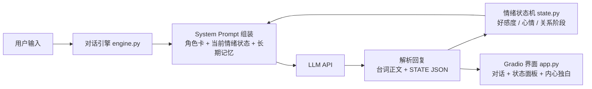

# 灰原哀 · 情感状态智能体 (Haibara AI)

一个基于 LLM 的角色扮演情感智能体：与《名侦探柯南》中的灰原哀对话，她的**好感度、心情、关系阶段**会随对话实时演化——从最初的冷淡戒备，到毒舌熟人，再到愿意袒露内心。说出口的台词之下，还能看到她的**内心独白**。


## 特性

- **情感状态机**：好感度（0-100，长期）与心情（-100~100，短期）双变量建模，每轮对话由 LLM 输出增量，程序端维护状态并限制单轮涨幅——好感需要慢慢"攻略"
- **五段关系阶段**：冷淡戒备 → 初步接纳 → 毒舌熟人 → 有限信任 → 袒露内心，阶段直接注入 System Prompt 驱动语气变化
- **内心独白**：每轮回复附带一句第一人称 OS，她说出口的，不一定是心里想的
- **长期记忆**：旧对话溢出上下文窗口时自动压缩为事实清单，她真的"记得"你说过的事
- **SVG 活体数字人**：纯代码绘制的 Q 版形象（无外部资源），会眨眼、呼吸；表情与氛围光晕随情绪实时联动——被夸时脸红瞥开眼、开心时笑弯眼飘爱心、被冒犯时冷脸警惕、受伤时低落
- **模型无关**：支持任意 OpenAI 兼容 API（智谱 GLM / DeepSeek / GPT-4o / 各类中转……），改三个环境变量即可切换；默认推荐免费的智谱 `glm-5.3-flash`
- **无 Key 演示模式**：未配置 API Key 时自动降级为脚本演示，界面和状态机照常运转，适合课堂展示

## 架构



每轮对话，LLM 除了输出角色台词，还会输出一个状态块：

```xml
<STATE>{"favorability_delta": 2, "mood_delta": 5, "inner_voice": "……哼，倒也不是完全没意思。"}</STATE>
```

程序端解析后更新状态机，并在下一轮把新状态注入 Prompt，形成闭环。

## 快速开始

```bash
# 1. 安装依赖（需要 Python 3.10+）
pip install -r requirements.txt

# 2. 配置 API：复制 .env.example 为 .env，填入你的 key
cp .env.example .env

# 3. 启动网页界面
python app.py        # 浏览器打开 http://127.0.0.1:7860

# 或者先用终端试聊，快速调人设
python cli.py
```

> **没有 API Key 也能跑**：未配置 `LLM_API_KEY` 时自动进入演示模式，用内置剧本回复，方便先看界面和状态机效果。

## 配置

| 环境变量 | 说明 | 默认 |
|---|---|---|
| `LLM_API_KEY` | API 密钥 | 不填则进入演示模式 |
| `LLM_BASE_URL` | OpenAI 兼容接口地址 | `https://open.bigmodel.cn/api/paas/v4/` |
| `LLM_MODEL` | 模型名 | `glm-4-flash`（智谱，永久免费） |

免费 Key 获取：注册 [智谱开放平台](https://open.bigmodel.cn) → 控制台「API Keys」→ 添加并复制。`glm-4-flash` 与 `glm-4.7-flash` 均可免费调用（后者高峰期限流 429 时换回前者）。

## 项目结构

```
haibara-ai/
├── app.py          # Gradio 网页界面
├── avatar.py       # SVG 活体数字人（表情随情绪联动）
├── cli.py          # 终端试聊工具（调人设用）
├── engine.py       # 对话引擎：LLM 调用、状态解析、长期记忆
├── character.py    # 灰原哀角色卡 + System Prompt 模板
├── state.py        # 情绪状态机（好感度 / 心情 / 阶段）
├── .env.example    # 配置模板
└── requirements.txt
```

## 调试指南

- **人设不像 / 语气不对**：只改 [character.py](character.py) 里的角色卡，用 `python cli.py` 快速验证
- **好感涨太快或太慢**：改 [state.py](state.py) 里的 `MAX_FAV_DELTA` 和各阶段阈值

## Roadmap

- [ ] 多角色扩展（角色卡插件化）
- [ ] 语音合成（TTS）朗读台词
- [ ] 情绪曲线可视化（一场对话的心情波动图）
- [ ] 部署到 Hugging Face Spaces

## 声明

本项目为粉丝同人性质的学习项目，仅供学习交流。灰原哀等角色版权归青山刚昌及小学馆所有，与官方无关。
